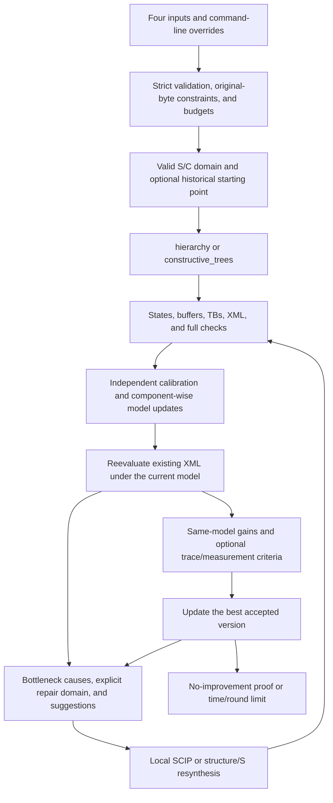

# VeriCCL v5 workflow

VeriCCL works with complete schedules that have explicit external semantics, can be lowered to native XML, and can be replayed under the current model. The initial algorithm generates candidates. Input checks, state semantics, runtime ordering, model evaluation, and acceptance criteria determine which candidates can be accepted.



Online measurements, omitted from the diagram, are controlled by input switches. An initial candidate can be retained while required costs are missing; it becomes the baseline once the full prediction and required checks pass. Repair candidates use the same lowering and checking path, including all correctness checks.

| Stage | Main code | Inputs and outputs |
|---|---|---|
| CLI | `vericcl/cli/main.py`, `cli/lifecycle.py`, `cli/live.py` | Four inputs, paths, and explicit overrides -> run context and exit status |
| Input and migration | `vericcl/input/schema.py`, `migration.py` | Original JSON -> effective request, value origins, and external contract |
| Topology and data | `vericcl/topology/`, `semantics/ranges.py`, `semantics/versions.py` | Ranks, links, resources, and original byte ranges -> valid transfers and state versions |
| Parameter domain | `vericcl/planner/parameters.py`, `xml/capacity.py` | M, datatype, collective, and runtime limits -> S/C candidates and lower bounds |
| Hierarchy | `vericcl/planner/group_search.py`, `solver/milp.py` | Groups, logical stages, and semantics -> coarse/fine candidates and subproblem reuse |
| Batch routing | `vericcl/solver/trees/packing.py`, `batch.py`, `timing.py` | Demand and capacity -> integer-slice routes, then timing for fixed routes |
| Runtime lowering | `vericcl/xml/v5_buffers.py`, `v5_program.py`, `v5_lower.py` | Network operations -> buffers, TBs, XML, independent checks, and full event graph |
| Performance model | `vericcl/performance/initial.py`, `model.py`, `simulation.py` | Initial or updated alpha, beta, and shared rates -> T_pred, critical events, and coverage gaps |
| Calibration | `vericcl/verification/online/probe_jobs.py`, `remote.py`, `campaign.py`, `component_fitting.py` | Independent probes -> raw samples, qualified components, and model differences |
| Bottlenecks and proofs | `vericcl/verification/bottlenecks.py`, `flow_index.py`, `proof_check.py`, `global_bound.py` | Full event graph -> causal region, strategy batches, outstanding obligations, or checkable certificates |
| Local repair | `vericcl/tuning/strategies.py`, `event_columns.py`, `resynthesis.py` | Explicit region and suggestions -> joint local solution or full resynthesis candidate |
| Main loop | `vericcl/workflow_v5.py`, `workflow_state.py` | Stage results -> incumbent, checkpoints, budgets, and stop reason |
| Runtime | `runtime/live/`, `runtime/probes/`, `runtime/msccl-trace/` | Checked manifest/XML -> GPU execution, counters, traces, and release receipts |
| Resident tuning | `vericcl/live/controller.py`, `adaptive.py`, `tuning.py`, `external.py` | Request telemetry and explicit faults -> background task, prepared version, and coordinated switch |

## Data and storage correctness

An original slice is identified by its source rank and reference partition. Forwarding or rerouting preserves the original data it represents. When S changes, constraints remain bound to the original byte ranges. Reduction combines ready states at the same logical position with disjoint contributors, and records the union of their contributors. Final outputs must contain exactly the contributions required by the collective.

Logical states and physical addresses are recorded separately. For example, when p and q are reduced and written back to A, A's old value becomes invalid after its last read, and the new state represents p+q. B can be released if it has no remaining readers; otherwise, it must be retained until the last read finishes. In-place AllGather/ReduceScatter also checks the actual aliasing of input and output subranges.

Network reduction pairs send with rrc, which includes both receive and reduce, so no extra reduction TB is added. By default, scheduling separates operations by rank, direction, peer, and channel, keeping slices separate. The final event graph includes local order after lowering, sender readiness waits, receiver dependencies, scratch reuse, and NOP dependencies. XML checks cover `cnt=1`, TB and instruction counts, dependency IDs, and offsets.

## Costs, concurrency, and comparisons

The initial model uses the explicit topology and initial local copy/reduce costs. The initial rrc estimate combines link and receive-reduce costs. Measured rrc service time replaces that estimate directly, avoiding double-counted reduction costs. As specified by the confirmed design, mixed interference between independent memory access and communication is ignored unless declared.

Event simulation updates the active mode and remaining bytes when a transfer starts or ends. Fixed startup cost is charged once; concurrency changes affect only the rate for the remaining transfer. Qualified measured modes use their rate vectors, while unmeasured modes retain explicitly marked bandwidth-sharing estimates. Version and coverage records include model parameters, applicable sizes, sources, measurement times, and exact identities.

Probes execute consecutive steps on the same TB (`calibration.chain_steps`) and fit average time per step. This captures overlap between consecutive operations. Cross-host probes use wall time per iteration to include network work staged through host memory when GPUDirect RDMA is unavailable.

The complete T_pred is the latest completion time across all required work. Floating-point avg divides the output after native summation. The event graph adds a final operation on each valid output rank, after that rank's XML work finishes. Its current cost uses the copy model for the same payload as a memory-access estimate. This final operation remains marked as estimated even when copy has been measured. If no component covers that size, the missing cost is reported rather than set to zero.

Candidates are compared with the incumbent reevaluated under the same current model. Given a known feasible T_pred, later solver branches can be pruned when a valid lower bound reaches it. A large observed duration alone does not justify pruning without a valid lower bound. SCIP's numerical optimality applies to the constructed model; routes, orderings, or structural branches not yet generated remain outside that proof.

## Repair, search, and termination

The repair domain follows the identified causes and may include related flows from multiple chunks, competing transfers, and dependencies. Data assignments, paths, communication resources, and relative order outside the domain remain fixed; timing is propagated again under the constraints. Suggestions are first converted into valid constraints. Local SCIP then jointly selects integer assignments, paths/channels, and valid orderings. The implementation expands event candidate columns progressively and checks a full physical replay after each optimization batch.

A change to S affects the partition globally, so legality and expected benefit are checked before resynthesis within the current repair budget. Hierarchy changes also use full synthesis. Search expansion first tries subdivision: `refine_network` in `tuning/resynthesis.py` splits each slice into 2, 4, or 8 pieces while preserving routes, channels, and TB order. Each piece remains within its original byte range. The resulting candidate passes full lowering and checks, then the configured model and measured-gain criteria. An accepted result can be refined again. Exhausting a finite candidate set expands the search or leaves an outstanding obligation. Termination records a time or round limit, or a checkable no-improvement certificate for the declared search space. The current global certificate requires the directed-cut lower bound to equal exact T_pred; fixed-decision enumeration certificates state their narrower scope.

## Full symbolic mode (`sketch.symbolic.enabled`)

This mode is off by default. When enabled, lowering checks, offline analysis, and bottleneck repair use `vericcl/symbolic_full/`:

| Module | Role |
|---|---|
| `xmlprog.py` | Independently parses XML without using objects from lowering. |
| `executor.py` | Models each XML step as a progress node with TB, flag, send/receive, and FIFO dependencies. Connection capacity follows message size and `NCCL_STEPS`/`MSCCL_CHUNKSTEPS`. A BDD over (node, iteration) represents K loops; layer removal yields execution order or a remaining wait cycle. Buffer versions record contributor BDDs, paths, and time expressions. Transfers create Symbols; writes create {s, pd, t} atoms. Loop iterations access disjoint subranges through gridOffset, so one iteration determines data semantics. |
| `checks.py` | Checks coverage by reachability, exact output contributions, ordered RAW/WAR/WAW accesses, forbidden bytes, gateways, progress at selected sizes, connection sequences, and agreement between XML and schedule transfers. |
| `hotspots.py`, `order.py` | Combines counters with BDD sets for congestion, idle links, data holders, allowed paths, backward reachability, and alternatives. Identifies related operations and suggests TB reordering where Inverted holds and Necessary does not. |
| `repair.py` | Builds the related-operation region and detour choices. BDD filtering removes invalid or conflicting combinations before applying atom constraints and local MILP. |

Symbolic results are cached by XML and request. Model updates rebind alpha, beta, and simulator-derived contention factors without repeating symbolic execution.

## Timing and run ownership

The budget manager tracks initial synthesis, online verification, offline verification, and repair time separately. It enforces per-round, cumulative, per-model, and total wall-clock limits. Cleanup reserves are deducted from the parent budget. Multiple suggestions, additional measurements, and resynthesis within one round share that round's budget. Checkpoint recovery preserves elapsed time, started round counts, and statistical IDs.

Subprocesses are identified by PID, process group, start time, and boot ID. A log write failure stops new work while retaining the incumbent and failure records. Process exit, completed stdout collection, and GPU release are recorded separately. Unresolved GPU ownership from previous runs remains recorded when a new command starts.

## Resident versions and recovery

A resident group has fixed rank membership and a CPU coordinator. Versions are stored immutably by XML content. The runtime prepares a separate communicator and resources, then uses READY, COMMIT, and START to adopt the version at a request boundary. Messages carry group, request, attempt, and version identities; retries resend the recorded decision. One background tuning task handles coalesced events, with explicit faults taking priority.

Recovery first signals cancellation while retaining resources, confirms that GPU work has stopped, and aborts the communicator. After every rank confirms STOPPED, it restores protected input, rebuilds a valid version, and replays the entire request. The default allows two additional retries within one fixed recovery deadline. A timeout alone does not identify a failed link. If membership, a valid route, or confirmed termination is missing, recovery retains the buffers and records an unresolved state.

The caller supplies external in-band telemetry. Set `live.external_telemetry_path` to an absolute path owned by the execution user, and append to the same regular file. Each record is at most 64 KiB, uses a timezone-aware timestamp, and expires after 60 seconds by default. An event_id identifies one immutable record. Use task_id from the current `run.json` as group_id.

```json
{"schema_version":1,"event_id":"health-0001","group_id":"current-task-id","source":"external_health","observed_at":"2026-01-01T00:00:00Z","kind":"link_failed","links":[[0,1]],"metrics":{}}
```

Replace the illustrative identity and timestamp with current values. source may be external_inband, external_health, or explicit fault_injection. For `cost_update`, metrics keys such as `link:0:1` or `rrc:0:1` must provide alpha_us, beta_us_per_byte, min_bytes, and max_bytes; the edge must appear in links. A service ratio measured at one size scales the existing model and remains an estimate, rather than an independent alpha/beta fit.

The C API executes native schedules; the Python controller handles automatic analysis and background solving. Applications using only the C API supply verified versions themselves or through an external controller. Detailed traces contain XML primitive events. CUDA event duration covers the complete native call, including final scaling for floating-point avg.
