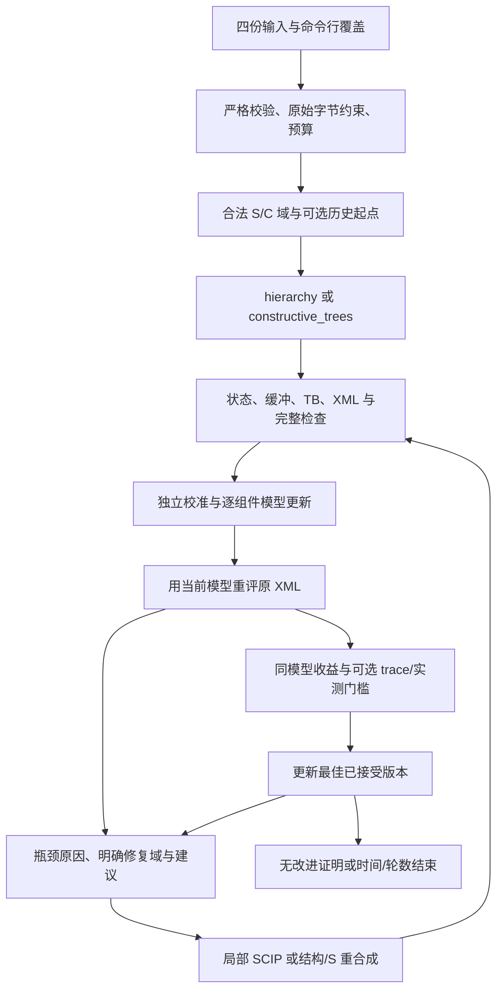

# VeriCCL v5 的完整流程

VeriCCL 的核心对象是“有明确外部语义、能降低为原生 XML、在当前模型下可重放的完整调度”。初始算法只提供候选；输入检查、状态语义、运行时编排、模型评估和接受门槛共同决定候选能否采用。

图中省略的在线测量由输入开关决定。初始候选在必要成本缺失时可先保留，但只有完整预测和必需检查通过后才能建立 baseline。修复候选经过同一条降低与检查路径；没有单独绕过正确性的快速接受入口。

| 环节 | 主要代码 | 输入与输出 |
|---|---|---|
| 公开命令 | `vericcl/cli/main.py`、`cli/lifecycle.py` | 四文件、路径和显式覆盖 → 运行上下文与退出码 |
| 输入与迁移 | `vericcl/input/schema.py`、`migration.py` | 原 JSON → 生效配置、默认来源、严格外部合同 |
| 拓扑与原始数据 | `vericcl/topology/`、`semantics/ranges.py`、`semantics/versions.py` | rank/link/resource 与原始字节范围 → 合法传输和状态版本 |
| 参数域 | `vericcl/planner/parameters.py`、`xml/capacity.py` | M、类型、算子、运行时上限 → S/C 候选与必要下界 |
| 分层求解 | `vericcl/planner/group_search.py`、`solver/milp.py` | 组、逻辑阶段与语义合同 → 粗/细候选及子问题复用 |
| 批量路由 | `vericcl/solver/trees/packing.py`、`batch.py`、`timing.py` | 需求与容量 → 整数 slice 路由，再求固定路由时序 |
| 运行时降低 | `vericcl/xml/v5_buffers.py`、`v5_program.py`、`v5_lower.py` | 网络操作 → 状态/缓冲、TB/XML、独立检查和完整事件图 |
| 性能模型 | `vericcl/performance/initial.py`、`model.py`、`simulation.py` | 初始/更新 α、β、共享速率 → T_pred、关键事件及缺失范围 |
| 校准 | `vericcl/verification/online/probe_jobs.py`、`remote.py`、`campaign.py`、`component_fitting.py` | 独立原语任务 → 原始样本、合格组件和模型差异 |
| 瓶颈与证明 | `vericcl/verification/bottlenecks.py`、`flow_index.py`、`proof_check.py`、`global_bound.py` | 当前完整事件图 → 因果范围、策略批次、未完成义务或可复查证明 |
| 局部修复 | `vericcl/tuning/strategies.py`、`event_columns.py`、`resynthesis.py` | 明确域和建议 → 联合局部解或完整重合成候选 |
| 运行记录 | `vericcl/execution/context.py`、`layout.py`、`publication.py` | 统一 run.json、顶层结果、process 历史与归档 |
| 主闭环 | `vericcl/workflow_v5.py`、`workflow_state.py` | 全部阶段结果 → incumbent、检查点、预算和停止原因 |
| 运行时 | `runtime/execution/`、`runtime/probes/`、`runtime/msccl-trace/` | 已检查 manifest/XML → 实际 GPU 执行、计数器、trace 和释放回执 |

## 数据与存储如何保持正确

原始 slice 身份由来源 rank 和参考分区确定。转发或改道不会改变它代表的原始数据；S 改变时，限制继续按原始字节范围绑定。归约只能合并相同逻辑位置、贡献者不重叠且已就绪的状态，结果记录贡献者并集。最终输出必须恰好包含算子要求的全部贡献。

逻辑状态和实际地址分别记录。例如 p 与 q 归约后写回 A，A 的旧值在最后一个读取结束后失效，新状态代表 p+q。B 若无后续读取即可释放；若仍有人要读取，必须保留到该读取结束。原位 AllGather/ReduceScatter 还要检查输入输出子区间的真实别名关系。

网络归约使用 send/rrc 配对，rrc 已包含接收和归约，不额外凭空增加一个归约 TB。默认按 rank、方向、peer 和 channel 分开编排，不合并 slice。降低后的本地顺序、发送端就绪等待、接收端依赖、scratch 复用和 NOP 依赖都会进入最终事件图。XML 的 `cnt=1`、TB 数、指令数、依赖编号和偏移均需校验。

## 代价、并发与比较

初始模型来自显式拓扑和本地 copy/reduce 初值。初始 rrc 使用链路加接收归约的估计；实测 rrc 服务时间直接替换它，避免重复加 reduce。独立访存与通信之间未声明的混合干扰按已确认设计忽略。

事件模拟在传输开始或结束时更新活跃模式与剩余字节。固定启动开销只支付一次；并发变化后只调整剩余传输速率。合格实测模式使用其速率向量，未测模式保留明确标记的带宽共享估计。模型参数、适用大小、来源、测量时间和精确身份共同进入版本与覆盖记录。

完整 T_pred 是全部必要工作结束的最晚时间。浮点 avg 在原生求和之后还有输出除法，事件图增加每个有效输出 rank 的末尾操作，并等待该 rank 的 XML 工作结束。目前其成本取同 payload 的 copy 模型作为访存估计，即使 copy 已测量，该末尾操作仍标记为 estimated。若没有覆盖该大小的组件，则报告缺项，不填零。

候选只与同一当前模型下重评的 incumbent 比较。有已知可行 T_pred 时，可靠下界达到它的后续求解分支可剪去；只观察到某段时间较大而没有合法下界时，不据此剪枝。SCIP 的数值最优只说明已建立的模型，不证明尚未生成的路由、顺序或结构分支。

## 修复、搜索和结束

修复域由实际原因确定，允许包含多个 chunk 的相关 flow、竞争传输与依赖。域外数据分配、路径、通信资源和相对顺序固定，时序按约束重新传播。建议先转成合法约束，再由局部 SCIP 联合选择整数分配、路径/channel 和合法顺序。实现使用逐步展开的事件候选列，每批优化后仍检查完整物理重放。

S 分支影响整个分区，因此先检查合法性和预期收益，再重新初始合成，并继续使用当前轮修复预算。分层结构变化也进入完整合成。有限候选用尽只扩大搜索或留下未完成义务；结束条件是完整合法空间的可复查无改进证据、时间限制或轮数限制。当前全局证书使用有向割下界与精确 T_pred 相等；更窄的固定决策枚举证书明确标注范围。

## 时间与运行归属

预算管理器分别记录初始、在线、离线和修复耗时，并限制每轮、累计、单模型和总墙钟期限。清理预留从父预算扣除。单轮多个建议、补测或重合成共享同一额度，恢复检查点不重置已消耗时间、已开始轮数或统计编号。

子进程以 PID、进程组、启动时间和 boot id 标识。日志写入失败会停止新工作，已有 incumbent 与失败记录保留。进程退出、stdout 收集完成和 GPU 释放分别记录。历史未解决 GPU 所有权不会因一次新命令而自动清空。

## 执行与资源释放

原生执行为一个固定调度装载 XML，先核对各 rank 的任务与数据语义，再完成 communicator 和缓冲区准备。同一运行上下文保持这个调度，预热、采样和 trace 都使用它。修复后的调度作为下一次独立验证的输入。

CPU 控制通道负责各 rank 的准备、启动和完成确认。GPU 事件记录完整调用时间；详细 trace 记录 XML 内各原语的执行。独立校准探针测量链路与计算开销，结果用于后续离线模型评估。

运行结束后分别确认 GPU 工作完成、缓冲区释放和子进程退出。完整回执保存在 process/jobs/，资源状态保存在 process/live/。恢复任务从已保存的检查点继续计算，沿用原任务身份、预算和统计编号。

## 手工约束和输出

手工阶段使用 atom.manual.nodes。每个节点的 atoms 给出 slice_ids、src_ranks、dst_ranks 三个变量集合，stage_id 从节点继承。进入求解器前取三个集合的全部组合，与已有 forbidden_transfers 合并成有向边禁用约束。约束绑定原始数据范围，替代路径仍经过其他语义、组边界和资源检查。manual.enabled=false 时这些变量组不参与自动合成。

运行目录的 run.json 汇总命令、原输入索引、生效配置、来源、数据量和结果。最终 XML、调度说明与对应模型以 schedule.xml、schedule.json、model.json 导出；每轮候选、模型版本和检查点保存在 process/。details.zip 是结束时的过程归档，process/ 保留用于检查和恢复。
