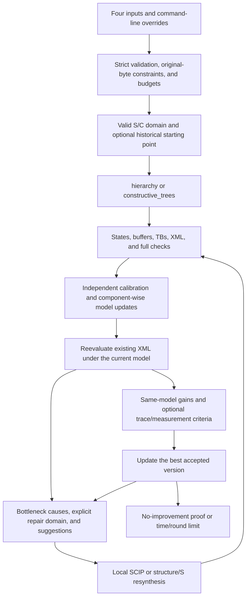

# VeriCCL v5 workflow

VeriCCL works with complete schedules that have explicit external semantics, can be lowered to native XML, and can be replayed under the current model. The initial algorithm generates candidates. Input checks, state semantics, runtime ordering, model evaluation, and acceptance criteria determine which candidates can be accepted.

Online measurements, omitted from the diagram, are controlled by input switches. An initial candidate can be retained while required costs are missing; it becomes the baseline once the full prediction and required checks pass. Repair candidates use the same lowering and checking path, including all correctness checks.

| Stage | Main code | Inputs and outputs |
|---|---|---|
| Public commands | `vericcl/cli/main.py`, `cli/lifecycle.py` | Four files, paths, and explicit overrides → run context and exit code |
| Inputs and migration | `vericcl/input/schema.py`, `migration.py` | Original JSON → effective configuration, sources of defaults, and strict external contract |
| Topology and original data | `vericcl/topology/`, `semantics/ranges.py`, `semantics/versions.py` | Ranks, links, resources, and original byte ranges → valid transfers and state versions |
| Parameter domain | `vericcl/planner/parameters.py`, `xml/capacity.py` | M, data type, collective, and runtime limits → S/C candidates and required lower bounds |
| Hierarchical solving | `vericcl/planner/group_search.py`, `solver/milp.py` | Groups, logical stages, and semantic contracts → coarse/fine candidates and subproblem reuse |
| Batch routing | `vericcl/solver/trees/packing.py`, `batch.py`, `timing.py` | Demands and capacity → integer slice routes, followed by timing for the fixed routes |
| Runtime lowering | `vericcl/xml/v5_buffers.py`, `v5_program.py`, `v5_lower.py` | Network operations → states/buffers, TBs/XML, independent checks, and a complete event graph |
| Performance model | `vericcl/performance/initial.py`, `model.py`, `simulation.py` | Initial/updated α, β, and shared rates → T_pred, critical events, and missing coverage |
| Calibration | `vericcl/verification/online/probe_jobs.py`, `remote.py`, `campaign.py`, `component_fitting.py` | Independent primitive jobs → raw samples, qualified components, and model differences |
| Bottlenecks and proofs | `vericcl/verification/bottlenecks.py`, `flow_index.py`, `proof_check.py`, `global_bound.py` | Current complete event graph → causal scope, strategy batches, unresolved obligations, or reviewable proofs |
| Local repair | `vericcl/tuning/strategies.py`, `event_columns.py`, `resynthesis.py` | Explicit domain and suggestions → joint local solution or fully resynthesized candidate |
| Run records | `vericcl/execution/context.py`, `layout.py`, `publication.py` | Unified run.json, top-level results, process history, and archive |
| Main loop | `vericcl/workflow_v5.py`, `workflow_state.py` | All stage results → incumbent, checkpoints, budgets, and stop reason |
| Runtime | `runtime/execution/`, `runtime/probes/`, `runtime/msccl-trace/` | Checked manifest/XML → actual GPU execution, counters, traces, and release receipts |

## Data and storage correctness

An original slice is identified by its source rank and reference partition. Forwarding or rerouting preserves the original data it represents. When S changes, constraints remain bound to the original byte ranges. Reduction combines ready states at the same logical position with disjoint contributors, and records the union of their contributors. Final outputs must contain exactly the contributions required by the collective.

Logical states and physical addresses are recorded separately. For example, when p and q are reduced and written back to A, A's old value becomes invalid after its last read, and the new state represents p+q. B can be released if it has no remaining readers; otherwise, it must be retained until the last read finishes. In-place AllGather/ReduceScatter also checks the actual aliasing of input and output subranges.

Network reduction pairs send with rrc, which includes both receive and reduce, so no extra reduction TB is added. By default, scheduling separates operations by rank, direction, peer, and channel, keeping slices separate. The final event graph includes local order after lowering, sender readiness waits, receiver dependencies, scratch reuse, and NOP dependencies. XML checks cover `cnt=1`, TB and instruction counts, dependency IDs, and offsets.

## Costs, concurrency, and comparisons

The initial model uses the explicit topology and initial local copy/reduce costs. The initial rrc estimate combines link and receive-reduce costs. Measured rrc service time replaces that estimate directly, avoiding double-counted reduction costs. As specified by the confirmed design, mixed interference between independent memory access and communication is ignored unless declared.

Event simulation updates the active mode and remaining bytes when a transfer starts or ends. Fixed startup cost is charged once; concurrency changes affect only the rate for the remaining transfer. Qualified measured modes use their rate vectors, while unmeasured modes retain explicitly marked bandwidth-sharing estimates. Version and coverage records include model parameters, applicable sizes, sources, measurement times, and exact identities.

The complete T_pred is the latest completion time across all required work. Floating-point avg divides the output after native summation. The event graph adds a final operation on each valid output rank, after that rank's XML work finishes. Its current cost uses the copy model for the same payload as a memory-access estimate. This final operation remains marked as estimated even when copy has been measured. If no component covers that size, the missing cost is reported rather than set to zero.

Candidates are compared with the incumbent reevaluated under the same current model. Given a known feasible T_pred, later solver branches can be pruned when a valid lower bound reaches it. A large observed duration alone does not justify pruning without a valid lower bound. SCIP's numerical optimality applies to the constructed model; routes, orderings, or structural branches not yet generated remain outside that proof.

## Repair, search, and termination

The repair domain follows the identified causes and may include related flows from multiple chunks, competing transfers, and dependencies. Data assignments, paths, communication resources, and relative order outside the domain remain fixed; timing is propagated again under the constraints. Suggestions are first converted into valid constraints. Local SCIP then jointly selects integer assignments, paths/channels, and valid orderings. The implementation expands event candidate columns progressively and checks a full physical replay after each optimization batch.

An S branch affects the entire partition, so legality and expected gains are checked before initial synthesis is rerun using the current round's repair budget. Hierarchical structure changes also require full synthesis. Exhausting a finite candidate set expands the search or leaves unresolved obligations. Termination requires reviewable no-improvement evidence over the full legal space, a time limit, or a round limit. The current global certificate establishes equality between a directed-cut lower bound and the exact T_pred. Narrower certificates based on enumerating fixed decisions state their scope explicitly.

## Timing and run ownership

The budget manager tracks initial synthesis, online verification, offline verification, and repair time separately. It enforces per-round, cumulative, per-model, and total wall-clock limits. Cleanup reserves are deducted from the parent budget. Multiple suggestions, additional measurements, and resynthesis within one round share that round's budget. Checkpoint recovery preserves elapsed time, started round counts, and statistical IDs.

Subprocesses are identified by PID, process group, start time, and boot ID. A log write failure stops new work while retaining the incumbent and failure records. Process exit, completed stdout collection, and GPU release are recorded separately. Unresolved GPU ownership from previous runs remains recorded when a new command starts.

## Execution and resource release

Native execution loads XML for one fixed schedule, checks each rank's task and data semantics, then prepares communicators and buffers. The run context retains this schedule for warmup, sampling, and tracing. A repaired schedule becomes the input to the next independent verification run.

A CPU control channel coordinates preparation, launch, and completion acknowledgments across ranks. GPU events record full invocation times, while detailed traces record the execution of individual XML primitives. Independent calibration probes measure link and computation costs for subsequent offline model evaluation.

At the end of a run, GPU completion, buffer release, and subprocess exit are confirmed separately. Full receipts are saved in process/jobs/, and resource states in process/live/. A resumed run continues from the saved checkpoint with its original identity, budgets, and statistical IDs.

## Manual constraints and outputs

Manual stages use atom.manual.nodes. Each node's atoms specifies three variable sets: slice_ids, src_ranks, and dst_ranks. The stage_id is inherited from the node. Before solving, all combinations of the three sets are combined with existing forbidden_transfers to form directed-edge constraints. Constraints bind to original data ranges, and alternative paths still undergo the other semantic, group-boundary, and resource checks. With manual.enabled=false, these variable groups are excluded from automatic synthesis.

The run directory's run.json summarizes the command, original input index, effective configuration, value sources, data sizes, and results. The final XML, schedule description, and corresponding model are exported as schedule.xml, schedule.json, and model.json. Candidates from each round, model versions, and checkpoints are saved in process/. At completion, details.zip archives the process records, while process/ remains available for inspection and recovery.
